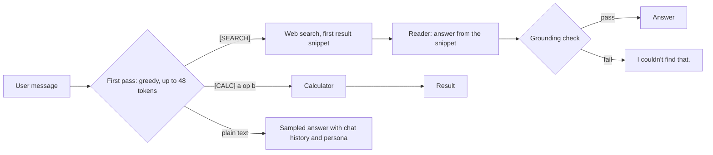

# Alpha: a 317M-parameter language model, built end to end, with tool use

Alpha is a decoder-only Transformer written from scratch in PyTorch: tokenizer, pretraining on ~12B tokens of FineWeb-Edu, instruction tuning, and a small tool-using assistant on top (web search for facts, a calculator for arithmetic). Every stage has an evaluation, and this README reports the numbers, including the ones that don't flatter the model.

> **Naming:** *Alpha* is the model; *Etra* is the assistant built on it (chat with history, web search, calculator).

## Quickstart

```bash
git clone -b Etra https://github.com/MehdiSkilll24/Alpha.git && cd Alpha
pip install torch==2.5.1 --index-url https://download.pytorch.org/whl/cu121   # CUDA 12.1 build
pip install -r requirements.txt
hf download MSkilll/Etra --include "checkpoints/checkpoint_sftv5.pt" --local-dir .
cd model && python inference.py --ckpt ../checkpoints/checkpoint_sftv5.pt
```

### Example session

```
prompt> Hi, who are you ?
I'm Alpha, a small aid designed to assist with basic tasks.

prompt> So what color is purple made of ?
Search mode...
In the RYB color model historically used in the arts, purple is a secondary color created by combining red and blue pigments. In the CMYK color model used in modern printing…

prompt> What's 5 - 7 ? 
[CALC] -2
```

## Highlights

- **A reasonable base for its size.** Trained from scratch (317M parameters, 92k steps, ~12B tokens): perplexity **16.2** on held-out FineWeb-Edu, **38.4%** on HellaSwag and **58.3%** on ARC-Easy, zero-shot.
- **Tool routing works.** The fine-tuned model decides on its own, in its first generated tokens, whether to emit `[SEARCH]`, `[CALC]`, or answer directly. On a 450-prompt held-out routing set, routing accuracy went from **73.3% (v4) to 88.9% (v5)** on the same prompts (+15.6 points, 95% CI +12.0 to +19.3), at the cost of about one perplexity point.
- **No false calculator calls on the test set.** Calc precision is **100%** for both versions (0 wrong `[CALC]` routes among the 450 test prompts), and calc recall rose from 50.7% to 80.7% (routing level; see Limitations for what the calculator can evaluate).
- **Search is what makes it useful.** On 968 TriviaQA questions, the base model answering from memory gets **11.9%**; the retrieval-augmented system gets **50.4%** with a search on every question (**38.5%** through the full routed system, which also refuses unsupported answers).
- **Evaluation you can trust and rerun.** Held-out splits, near-duplicate checks against the training data, paired confidence intervals, frozen search caches, and resumable runs. Everything reproduces offline once the caches are built.

## What's in the box

| Stage | What it is |
|---|---|
| Architecture | Decoder-only, 316.7M parameters: 16 layers, d_model 1280, grouped-query attention (8 query heads, 2 KV heads, head dim 160), RoPE (2048 context), pre-LayerNorm, SwiGLU MLP (hidden width 2752, about 2/3 of a nominal 4096, rounded to a multiple of 64), untied output head, 32,000-token vocabulary, no dropout |
| Tokenizer | Byte-level BPE (Hugging Face `tokenizers`) with `<pad> <unk> <bos> <eos>` |
| Pretraining | FineWeb-Edu `sample-10BT`, 92,000 steps x 131,072 tokens/step (~12B tokens), AdamW (0.9, 0.95) with weight decay 0.1 on weight matrices, cosine LR 3e-4 to 3e-5, bf16, gradient clipping 1.0, one Colab A100. Final validation loss 2.78 (perplexity 16.2) |
| Instruction tuning | Full fine-tune, 3 epochs, LR 3e-5, loss on answer tokens only. Mix: filtered Alpaca-cleaned, SmolTalk chat, 15k TriviaQA `[SEARCH]` examples, 8k generated `[CALC]` examples, passage-grounded reader data (TriviaQA, MS MARCO, ASQA, Wikipedia), identity data, and (v5) a routing-fix set |
| Inference | KV cache, multi-turn history truncated to the 2048 context, persona system prompt, top-k / top-p / repetition-penalty sampling. Search goes through `ddgs` (Bing/Brave/Yahoo backends) and uses the first result's snippet, with a repair step for glued words. The calculator evaluates one binary operation (`a op b`) |

### How a message flows through the assistant



The router is not a separate classifier: it is the language model itself, taught by fine-tuning to start its answer with a tool tag when one is needed. The grounding check is a lexical filter: at least 60% of the answer's words, and every number in it, must appear in the retrieved text.

## Results

### 1. Base model (pretrained only)

| Metric | Result |
|---|---|
| Perplexity, held-out FineWeb-Edu | 16.19 |
| HellaSwag (zero-shot, acc_norm, n=10,042) | 38.4% |
| ARC-Easy (zero-shot, acc, n=2,376) | 58.3% |

The ARC-Easy score is probably helped by FineWeb-Edu's educational filtering.

### 2. What fine-tuning costs in general ability

| Model | Perplexity | HellaSwag (acc_norm) | ARC-Easy (acc) |
|---|---|---|---|
| Base | 16.19 | 38.4% | 58.3% |
| SFT v4 | 26.05 | 37.4% | 52.4% |
| SFT v5 (routing fix) | 27.03 | 37.3% | 50.9% |

Most of the cost comes from instruction tuning itself (base to v4). The v5 data fix added about one perplexity point, left HellaSwag unchanged, and moved ARC-Easy by about 1.5 points, which is borderline given a ~1% standard error. HellaSwag/ARC measure raw-text likelihood, not what instruction tuning is for, so judge the model by sections 3 and 5.

### 3. Routing: v4 to v5

**Setup.** A 900-prompt eval with 300 prompts per class (search, calc, answer), split into dev and test (450 each). v4 and v5 are scored on the **same 450 test prompts**.

**What changed in v5.** The same model, retrained from the base checkpoint with identical hyperparameters, with ~5k extra examples: (a) generated calc phrasings that v4 had never seen (unit conversions, word problems, question-style arithmetic such as "What does 12 * 7 equal?"), keeping only expressions the real calculator evaluates correctly; (b) wh-questions that should *not* search, converted from the existing passage data into the shape production uses (question and passages in one message); (c) non-wh phrasings of search questions and real-time queries (weather, prices, news).

| | v4 | v5 |
|---|---|---|
| **Overall accuracy** | 73.3% | **88.9%** |
| Search recall / precision | 94.7% / 70.3% | 96.0% / 88.3% |
| Calc recall / precision | 50.7% / 100% | 80.7% / 100% |
| Answer recall / precision | 74.7% / 65.1% | 90.0% / 81.3% |

v5 fixed 77 prompts v4 got wrong and newly broke 7. On a separate dev set v5 scores 89.6%, consistent with test.

| Class | Category | v4 | v5 |
|---|---|---|---|
| answer | information extraction | 7/20 | 19/20 |
| answer | closed-book QA with passage | 12/19 | 19/19 |
| answer | summarization | 12/19 | 19/19 |
| answer | classification / option lists | 13/20 | 11/20 |
| answer | brainstorming | 25/26 | 24/26 |
| answer | creative writing | 23/26 | 23/26 |
| answer | identity | 10/10 | 10/10 |
| answer | chat | 10/10 | 10/10 |
| calc | word problems | 0/21 | 17/21 |
| calc | unit conversion | 0/12 | 9/12 |
| calc | percent / tips / discounts | 6/18 | 15/18 |
| calc | powers and roots | 0/12 | 5/12 |
| calc | "What is ...?" arithmetic | 17/21 | 21/21 |
| calc | named operations ("sum of", "quotient of") | 8/15 | 10/15 |
| calc | verb leads ("Evaluate", "Solve") | 14/18 | 13/18 |
| calc | multi-step expressions | 13/15 | 13/15 |
| calc | symbolic ("17 * 23") | 18/18 | 18/18 |
| search | TriviaQA-style | 68/68 | 68/68 |
| search | Natural Questions-style | 62/67 | 61/67 |
| search | real-time (weather, news, prices) | 12/15 | 15/15 |

The largest gains are exactly where v4 sent everything to web search: questions with a pasted passage, and arithmetic phrased as a question.

*Routing only:* these rows test whether the model picked the right tool. The calculator evaluates a single binary operation (`a op b`), so for percent, power, root, and multi-step prompts a correct `[CALC]` route still ends in "Couldn't parse that expression." That is safer than the made-up numbers v4 produced for the same prompts, but it is not a correct answer.

### 4. What routing adds over a plain language model

A model without tools can only answer directly. On the balanced routing set, "always answer" would be right on the answer third only (33.3%; this is a property of the set, not a measurement of the base checkpoint). The measured evidence of what tools add:

- **Facts (measured):** on 968 TriviaQA validation questions, the base model answering from memory scores 11.9% versus 50.4% with retrieval (section 5).
- **Arithmetic (examples from v4 outputs, before the fix):** when math is not routed, a model this small computes it itself and gets it wrong:

| Prompt | Model answered directly | Correct |
|---|---|---|
| A box holds 40 tickets. How many tickets are in 5 boxes? | "There are 20 tickets in 5 boxes." | 200 |
| Calculate 25 percent of 20. | "25% of 20 is 25." | 5 |
| Find the quotient of 75 and 25. | "The quotient of 75 and 25 is 25." | 3 |

When a prompt is routed to `[CALC]` with a single operation, the calculator's result is exact, and calc precision (never invoked on non-math prompts) is 100%. Whether the model writes the *correct* expression was not evaluated.

### 5. End to end: retrieval-augmented QA on TriviaQA (v5, n=968)

Questions come from TriviaQA validation (shuffle seed 0), with web results prefetched once and frozen so the eval is reproducible. The metric is *contains* (an alias appears in the answer as whole tokens); EM and F1 are near zero by construction because the reader answers in full sentences.

| System | contains | 95% CI |
|---|---|---|
| Closed-book (base model, 5-shot) | 11.9% | +/- 2.0% |
| Always retrieve (SFT v5 reader) | 50.4% | +/- 3.1% |
| Routed (full system, with grounding check) | 38.5% | +/- 3.1% |

Where the points go:

| Diagnostic | Value |
|---|---|
| Retrieved snippet contains the answer | 69.3% |
| Reader accuracy when the answer is in the snippet | 70.2% |
| Reader accuracy when it is not | 5.7% |
| Routed system: chose to search | 99.4% |
| Routed system: refused ("I couldn't find that.") | 36.5% |
| Routed system: accuracy on the questions it answered | 60.7% |

The grounding check is a precision/coverage trade: it refuses about half of the wrong answers (240 of 480) but also 23% of the correct ones (113 of 488). It raises accuracy-when-answering from 50.4% to 60.7%, at the cost of answering only 63.5% of questions.

## How the evaluations work

Held-out splits, near-duplicate checks against the training data, frozen search caches, and paired bootstrap intervals for model-vs-model differences. Per-eval details (`eval.py`/ `eval_routing.py`, `eval_trivia.py`) are in [docs/evaluation.md](docs/evaluation.md).

## Limitations

These are measured, not hypothetical.

**Model and reader**
- It is a 317M-parameter model. Even when the retrieved snippet contains the answer, the reader misses it 30% of the time, typically by restating the question, inventing an entity, or rambling past the answer (the answers are long: median 35 words).
- When the snippet lacks the answer (31% of questions), the reader answers anyway: 149 confidently wrong answers got past the grounding check. A lexical overlap check cannot detect an invented answer.
- Retrieval uses only the first search result's snippet.

**Routing**
- Calc recall is 80.7%, not 100%. Weakest: powers and roots (5/12), named operations (10/15), and "Evaluate/Solve" leads (13/18). Unrouted arithmetic is answered wrongly by the model itself.
- **The calculator parses a single binary operation (`a op b`) with `+ - * /`.** Percentages, powers, roots, and multi-step expressions can be routed to it correctly but not evaluated: they end in "Couldn't parse that expression." (safer than a made-up number, but not an answer). The routing eval checks the tool tag only, not whether the model wrote the right expression, so end-to-end calculator accuracy was not measured.
- Option-list classification prompts ("Identify which instrument is string or percussion: ...") still go to search (9 of the 15 answer-to-search misses; this category got slightly worse in v5).
- Search recall on lowercase, Natural Questions-style prompts is 61/67 and some of those prompts are arguably ambiguous.
- Routing ignores conversation history, so a follow-up like "and what about Germany?" has no context for the router.

**Evaluation caveats**
- **The routing test set was inspected during development**: v4's test failures guided what data v5 added. Dev (89.6%) and test (88.9%) agree, which suggests no large inflation, but treat test as "inspected", not pristine.
- **The routing eval is partly in-distribution for calc**: the generated calc phrasings in the training fix and the eval share template families, and 22 of the 450 test prompts are near-duplicates of training prompts (v5 accuracy excluding them: 88.3%). The hand-written prompts are the real out-of-distribution check.
- HellaSwag/ARC use a custom scorer, not identical to `lm-evaluation-harness`; compare with published numbers cautiously.
- No baseline models (e.g. GPT-2 small/medium) were run through the same scorer, so how Alpha compares at its size is not quantified.
- TriviaQA is in-distribution for the router and reader (both were trained on TriviaQA-derived data), so routing-to-search on it is not evidence of generalisation, and *contains* is lenient with long answers: counting only the first sentence gives 44.4% for always-retrieve instead of 50.4%.
- Single training run per version; no seed variance is measured. Intervals are +/-3% at these sample sizes.

**Cost of fine-tuning**
- Instruction tuning raises raw-text perplexity from 16.2 to 27.0 and lowers ARC-Easy from 58.3% to 50.9%. Techniques that limit forgetting (data replay, LoRA) were not tried.

**Scope**
- A research and learning project: no safety or alignment work, and it will hallucinate. Context length is 2048 tokens. Live web search is not deterministic; the evals use a frozen cache.

## What I would do next

1. Extend the calculator (multi-step expressions, percentages, powers, roots), add matching training data and phrasing diversity, and evaluate the expressions the model writes end to end, on fresh hand-written prompts.
2. Use the top 2-3 snippets instead of one to raise the retrieval ceiling.
3. Tune the grounding check offline (`tune_grounding.py`: answer truncation and thresholds, chosen on one half of the questions and verified on the other) and rerun the RAG eval.
4. Compare full fine-tuning, fine-tuning with pretraining-data replay, and LoRA, judged on routing accuracy and perplexity.

## Reproducing

Layout (run each script from its own folder; paths between folders use `../`):

```
Alpha/
  requirements.txt         # run the assistant
  requirements_train.txt   # data prep, training, evals (includes requirements.txt)
  model/           # architecture, tokenizer, pretraining, SFT, inference, search, calculator, prompts
  DS/              # pretraining data: fetchds.py, Dataset.py
  DS_generation/   # SFT and eval data builders
  evals/           # eval.py, eval_routing.py, eval_trivia.py
  data/            # committed result files and the search cache
  jsons/           # tokenizer, config, SFT datasets
  checkpoints/     # downloaded from the Hub, not in git
  docs/            # evaluation details, data sources and licenses
```

Setup, once, from the repo root:

```bash
pip install torch==2.5.1 --index-url https://download.pytorch.org/whl/cu121
pip install -r requirements_train.txt   # requirements.txt is enough if you only want to chat
hf download MSkilll/Etra --include "checkpoints/*" --local-dir .
```

Then:

```bash
# 1. data + pretraining
cd DS
python fetchds.py                  # tokenize FineWeb-Edu into train.bin / val.bin
cd ../model
python train.py                    # resumes from checkpoint_latest.pt

# 2. SFT data, then fine-tune
cd ../DS_generation
python search_ex.py; python calc_ex.py; python marcods.py
python reader_triviaqa.py; python asqa.py; python reader_wiki.py; python make_chat.py
cd ../model
python identity.py
python sft.py --out ../checkpoints/checkpoint_sftv5.pt

# 3. evaluations
cd ../evals
python eval.py --ckpt ../checkpoints/checkpoint_sftv5.pt --out eval_sftv5.json
cd ../DS_generation
python build_routing_eval.py --hand routing_test.json --train-files ../jsons/*.json 
cd ../evals
python eval_routing.py --ckpt ../checkpoints/checkpoint_sftv5.pt --prompts routing_test.json
cd ../DS_generation
python prefetch.py
cd ../evals
python eval_trivia.py --sft ../checkpoints/checkpoint_sftv5.pt --base ../checkpoints/checkpoint_latest.pt

# 4. chat
cd ../model
python inference.py --ckpt ../checkpoints/checkpoint_sftv5.pt
```

**Note on `reader_triviaqa.json`.** The committed `jsons/reader_triviaqa.json`, which the released model was trained on, was built by an earlier version of `reader_triviaqa.py` (then `rag_ex.py`) that retrieved 3 passages per question from a local retrieval index, since removed from the repo. The current script uses live web snippets and writes to the same path, so running it **overwrites** the committed file with different data and does not reproduce the data behind the reported numbers. Back the file up first, or restore it afterwards with `git checkout -- jsons/reader_triviaqa.json`. 
Inference effects are indifferent since the model was trained (and evaluated) on 3 snippets but uses one during inference. This was due to an unstable version yielded by the 3 snippet result.

Result files and the search cache (`hits_snippets.json`) are committed in `data/`, so the numbers above can be checked without rerunning anything. Model weights (base and fine-tuned checkpoints) are on the Hugging Face Hub: [MSkilll/Etra](https://huggingface.co/MSkilll/Etra/tree/main/checkpoints). V5 being the latest version.

## License and attribution

| Component | License | What it means |
|---|---|---|
| Code (this repository) | [MIT](LICENSE) | Free to use, modify, and distribute. Keep the copyright notice in copies. |
| Model weights | [CC BY-NC 4.0](https://creativecommons.org/licenses/by-nc/4.0/) | Attribution required; non-commercial use only. The fine-tuning data includes Alpaca-derived data, which is non-commercial and restricts models trained on it to research use. |

**If you use or build on this work, please credit it as the original**: name the project (Alpha by MSkilll), link to this repository and the [weights](https://huggingface.co/MSkilll/Etra), and state any changes you made. MIT already requires the copyright notice to stay in copies of the code; the weights license requires attribution; and for papers, reports, or derived projects, please cite:

```bibtex
@misc{alpha2026,
  title        = {Alpha: a 317M-parameter language model with tool use, built end to end},
  author       = {MSkilll},
  year         = {2026},
  howpublished = {\url{https://huggingface.co/MSkilll/Etra}}
}
```

### Data sources

Every dataset, what it was used for, and its license: [docs/data-sources.md](docs/data-sources.md). I am not a lawyer; this describes intent and sources, not legal advice.
